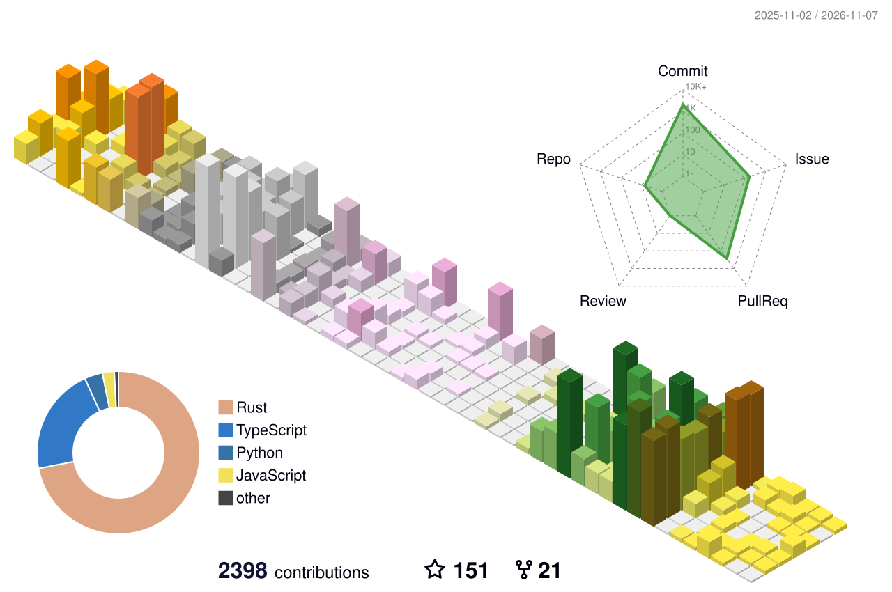

<details>
<summary>Click here for detailed stats!</summary>

<!--START_SECTION:waka-->


**🐱 My GitHub Data** 

> 📦 515.1 kB Used in GitHub's Storage 
 > 
> 🏆 1,948 Contributions in the Year 2026
 > 
> 🚫 Not Opted to Hire
 > 
> 📜 25 Public Repositories 
 > 
> 🔑 36 Private Repositories 
 > 
**I'm a Night 🦉** 

```text
🌞 Morning                1546 commits        █░░░░░░░░░░░░░░░░░░░░░░░░   05.60 % 
🌆 Daytime                11197 commits       ██████████░░░░░░░░░░░░░░░   40.55 % 
🌃 Evening                9696 commits        █████████░░░░░░░░░░░░░░░░   35.11 % 
🌙 Night                  5177 commits        █████░░░░░░░░░░░░░░░░░░░░   18.75 % 
```


📊 **This Week I Spent My Time On** 

```text
💬 Programming Languages: 
Python                   9 hrs 51 mins       ████████████░░░░░░░░░░░░░   47.54 % 
Other                    7 hrs 29 mins       █████████░░░░░░░░░░░░░░░░   36.17 % 
Text                     1 hr 16 mins        ██░░░░░░░░░░░░░░░░░░░░░░░   06.17 % 
Bash                     1 hr 7 mins         █░░░░░░░░░░░░░░░░░░░░░░░░   05.44 % 
JSON                     58 mins             █░░░░░░░░░░░░░░░░░░░░░░░░   04.68 % 

🔥 Editors: 
VS Code                  20 hrs 43 mins      █████████████████████████   100.00 % 

💻 Operating System: 
Linux                    20 hrs 43 mins      █████████████████████████   100.00 % 
```

🤖 **AI Coding This Week** 

```text
No AI Coding Activity Tracked This Week
```


<!--END_SECTION:waka-->
</details>
