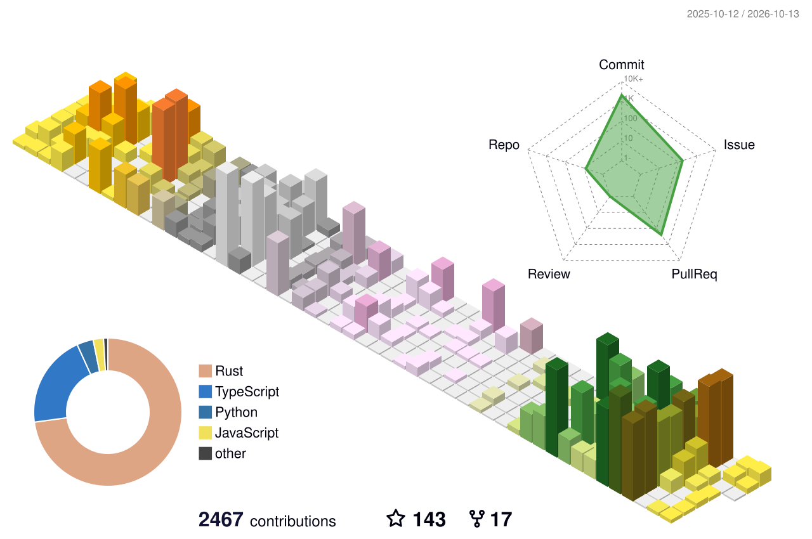

<details>
<summary>Click here for detailed stats!</summary>

<!--START_SECTION:waka-->


**🐱 My GitHub Data** 

> 📦 514.9 kB Used in GitHub's Storage 
 > 
> 🏆 1,945 Contributions in the Year 2026
 > 
> 🚫 Not Opted to Hire
 > 
> 📜 25 Public Repositories 
 > 
> 🔑 36 Private Repositories 
 > 
**I'm a Night 🦉** 

```text
🌞 Morning                1512 commits        █░░░░░░░░░░░░░░░░░░░░░░░░   05.62 % 
🌆 Daytime                10835 commits       ██████████░░░░░░░░░░░░░░░   40.28 % 
🌃 Evening                9443 commits        █████████░░░░░░░░░░░░░░░░   35.11 % 
🌙 Night                  5107 commits        █████░░░░░░░░░░░░░░░░░░░░   18.99 % 
```


📊 **This Week I Spent My Time On** 

```text
💬 Programming Languages: 
Other                    9 hrs 11 mins       ███████████░░░░░░░░░░░░░░   45.38 % 
Python                   7 hrs 3 mins        █████████░░░░░░░░░░░░░░░░   34.84 % 
Bash                     1 hr 36 mins        ██░░░░░░░░░░░░░░░░░░░░░░░   07.97 % 
JSON                     1 hr 27 mins        ██░░░░░░░░░░░░░░░░░░░░░░░   07.23 % 
Text                     55 mins             █░░░░░░░░░░░░░░░░░░░░░░░░   04.58 % 

🔥 Editors: 
VS Code                  20 hrs 16 mins      █████████████████████████   100.00 % 

💻 Operating System: 
Linux                    20 hrs 16 mins      █████████████████████████   100.00 % 
```

🤖 **AI Coding This Week** 

```text
No AI Coding Activity Tracked This Week
```


<!--END_SECTION:waka-->
</details>
